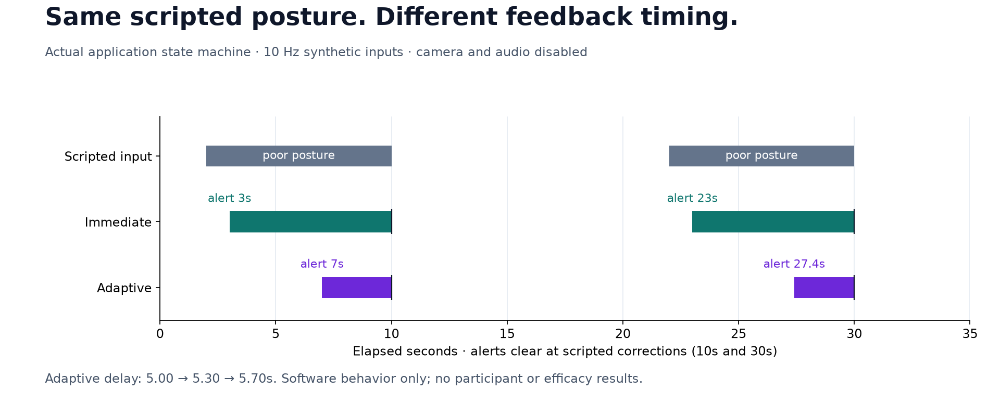

# PostureAware

**A local webcam application for comparing immediate and adaptive posture feedback.**

Calibrate a personal baseline, monitor upper-body posture, provide visual and optional audio cues, and summarize a session. A team project for Georgia Tech's Health Sensing and Interventions course. Application code was developed with AI assistance; see [the code-development disclosure](AI_USAGE.md).

[Run locally](#run-locally) · [Synthetic feedback demo](#see-the-feedback-logic) · [Validation](docs/VALIDATION.md)

## See the feedback logic



The same synthetic posture sequence is passed to the application's actual feedback function. Poor-posture intervals start at 2s and 22s; scripted corrections occur at 10s and 30s. Colored bars show when an alert is active.

| Mode | First alert | Second alert | What changes |
|---|---:|---:|---|
| Immediate | 3.0s | 23.0s | 1-second poor-posture threshold; the inter-alert gap rule also applies |
| Adaptive | 7.0s | 27.4s | Delay updates from 5.00 → 5.30 → 5.70 seconds after scripted corrections |

These are **software behavior results from generated inputs**, not participant measurements or evidence of intervention efficacy. The 10 Hz input schedule and floating-point threshold comparison affect exact alert times. [Trace CSV](docs/demo/feedback-trace.csv) · [Event log](docs/demo/feedback-events.json) · [Run summary](docs/demo/feedback-summary.json).

## Application flow

**Register → calibrate → monitor → receive feedback → review a session summary.**

| Stage | Function |
|---|---|
| Calibrate | Check lighting and estimate a neutral-posture baseline |
| Monitor | Track neck tilt, shoulder tilt, and face proximity with MediaPipe |
| Respond | Show posture cues; optionally play audio; update adaptive delay from correction latency |
| Summarize | Save local session summaries and questionnaire responses |

**Verified:** four hardware-free tests passed, plus the new feedback demo's timing, correction, and delay checks. Camera tracking, audible feedback, and complete 30-minute sessions were not revalidated. The original study involved 13 participants; no participant records or study outcome figures are distributed here.

## Run locally

Use **Python 3.11 or 3.12**; the tested environment is Python 3.12 on macOS ARM64.

```bash
python3 -m venv .venv
source .venv/bin/activate
# Windows PowerShell: .venv\Scripts\Activate.ps1
python -m pip install -r requirements.txt
python app.py
```

Open `http://127.0.0.1:5000` on the computer running Python. The camera and audio belong to that computer. Use one local session at a time; the app has shared camera, pose, and session state.

Audio installation is documented in [SETUP.md](SETUP.md). Without PyAudio, the app runs silently with a warning; audible feedback requires the optional audio dependencies. The monitor page loads Socket.IO JavaScript from a CDN. Pose processing and study-session files remain local; this edition is not entirely offline.

### Reproduce the synthetic figure

```bash
python -m pip install -r requirements-viz.txt
python examples/feedback_demo.py
```

Outputs go to `output/feedback-demo/`. The script blocks camera opening, suppresses audio calls, supplies generated good/poor classifications, and exercises the unchanged feedback state machine. It does not test pose classification or write participant session files. MediaPipe initialization still requires a supported graphics environment.

### Run the checks

```bash
python -m pip install -r requirements-dev.txt
python -m pytest -q
```

The tests cover baseline calibration, synthetic lighting, Flask registration/pages, and temporary synthetic record creation. [Validation](docs/VALIDATION.md) records the MediaPipe wheel-metadata caveat and dependency warnings.

## Data and source

Original participant records, questionnaires, logs, recordings, and the study report are excluded. The only distributed trace is generated by the synthetic feedback demo. Running the app can create new local records under `data/`; keep them private. [Data handling](docs/DATA_HANDLING.md).

| Path | Purpose |
|---|---|
| `app.py` | Flask/Socket.IO app, pose metrics, feedback state machine |
| `calibration.py` / `audio_alerts.py` | Baseline calibration and optional generated chimes |
| `templates/` | Local registration, calibration, monitor, survey, and results pages |
| `examples/feedback_demo.py` | Hardware-free synthetic feedback visualization |
| `tests/` / `docs/` | Checks, source records, validation, and data boundaries |

[Source and changes](docs/PROVENANCE.md) retain upstream provenance and distinguish the original application from later packaging, local server defaults, checks, and the synthetic visualization. The archived app does not contain the analysis/export scripts referenced in its old setup guide, so this edition does not reproduce the original study statistics.

No license file was present in the supplied source snapshot, and no additional redistribution rights are granted. [NOTICE](NOTICE.md).
